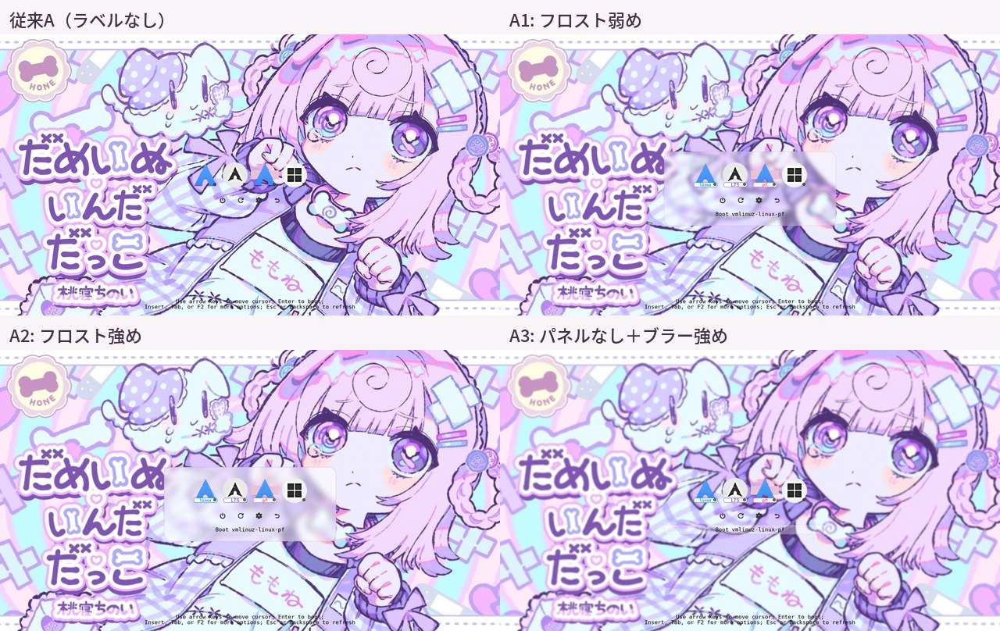
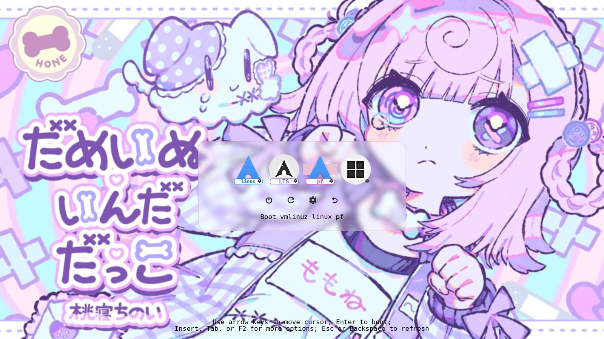
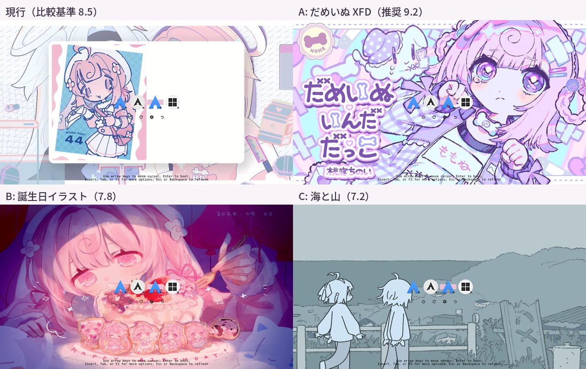

# refind-momone-readable

rEFInd 0.14.2 のブートメニューを、画像の右側の白い余白に寄せることはできない。メニュー位置は固定のため、代わりに「メニューが固定表示される位置に合う背景画像」を集め、アイコンにカーネル名を埋め込んで識別できるようにしたもの。

## このリポジトリに入っているもの

- 適用済み **A1** テーマ一式 `improved/`（`background.png` にブラーとフロストパネルを合成済み、`icons/` は全アイコンにカーネル名ラベル付き）
- 再現用のシミュレータとテスト、座標仕様と評価の全記録（`REPORT.md` / `DESIGN-readability.md`）

ESP へコピーした内容は `improved/` と同一。ESP 自体はこのリポジトリの外にあり、再起動・実機確認はまだ行っていない。

## プレビュー（実機ではなく、rEFIndの座標仕様による再現レンダー）

従来のAと、実装した x カーネル別アイコン + フロストパネルの A1/A2/A3 の比較。



適用済み A1 の 2560×1440 背景（パネルとブラーを書き込んだ実適用ファイルの再現）。



従来の候補A（だめいぬ XFD）と、画像生成の比較の様子。



## 適用状態（ESP `/boot/EFI/refind/`）

ESP に **A1 テーマを適用済み**（2026-11-21）。適用前のファイルは `/boot/EFI/refind/backups/20261121-182453/` にある。再起動しての実機確認はまだ行っていない。

- `refind.conf`: `include themes/MomoneChinoi-readable/theme.conf`
- `themes/MomoneChinoi-readable/`: A1 背景とラベル入りアイコン
- `vmlinuz-linux.png` / `vmlinuz-linux-lts.png` / `vmlinuz-linux-pf.png`: カーネル名入りに差し替え

## ディレクトリ

| パス | 内容 |
|---|---|
| `simulate_refind.py` | 背景画像に rEFInd メニューを重ねて再現レンダーする CLI |
| `readability_assets.py` | カーネル名アイコンの生成・背景のブラー/パネル効果 |
| `improved/` | 適用済み A1 テーマの一式（ESP へコピーした内容） |
| `base-icons/` | ESP 変更前の原版アイコン。再現の基準 |
| `tests/test_readability.py` | 再現の座標・バリアント・既存出力の回帰を検査するテスト |
| `final-renders/` | 従来AとA1/A2/A3の比較シートと推奨案レンダー |
| `REPORT.md` | 候補収集・座標仕様・評価の全記録 |
| `DESIGN-readability.md` | 可読性改善の設計（A1 採用の経緯） |

`candidates/`（31枚）と `renders/`（不採用案を含む全レンダー）はリポジトリに含めていない。danbooru/pixiv/YouTube 由来の第三者著作物のため。出典 URL は `REPORT.md` に残している。

## テスト

```bash
python3 -m unittest tests/test_readability.py -v
```

ESP への書き込みは行わない。再起動もしない。

## 注意

- 背景は桃寝ちのい（Momone Chinoi）の二次創作素材。商用利用や再配布の権利はない
- rEFInd の標準では選択名は長さに応じた縮小描画がない。長いエントリ名は再現と実機で見え方が異なる
